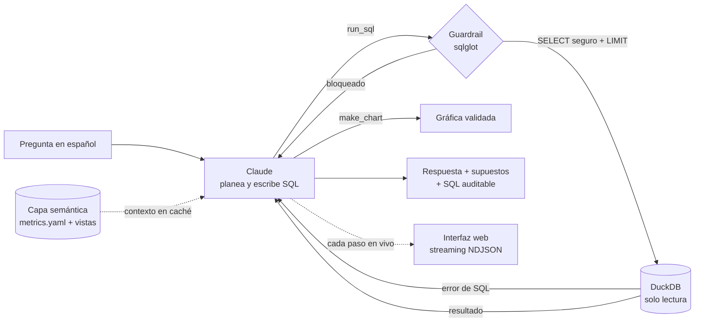

# Pulso · agente de analytics para métricas SaaS

**Pregúntale a tus datos de negocio en español y recibe una respuesta auditable: el número, la consulta que lo produjo, una gráfica y lo que deberías revisar después.**

Pulso es un agente de IA que traduce preguntas de Ventas, Marketing, Customer Success y Finanzas a SQL sobre una capa semántica gobernada (MRR, ARR, NRR, GRR, churn, CAC, LTV). Valida cada consulta antes de ejecutarla, se corrige solo cuando una consulta falla y se mide contra un set de preguntas con respuesta conocida.

> Es la versión pública y reconstruida desde cero de un agente de lenguaje natural a SQL que construí en mi trabajo anterior, usado por 15+ personas de ventas y sales ops (70+ consultas por semana). Aquí corre sobre datos sintéticos de una SaaS para PyMEs en LatAm para poder mostrarlo abiertamente.

---

## El problema

En una empresa SaaS en crecimiento, el equipo de datos se convierte en un cuello de botella:

- **Preguntas repetitivas.** "¿Cuánto churn tuvimos en Colombia?", "¿cuál es el CAC de Meta este trimestre?". Cada una espera días en la fila del analista.
- **Números que no cuadran.** Cada equipo calcula el churn o el NRR a su manera, y en la junta hay tres cifras distintas para la misma métrica.
- **Desconfianza en la IA.** Un chatbot que "inventa" un número es peor que no tener nada.

## La solución

Un agente que **solo puede responder con datos que consultó**, usando **definiciones únicas** de cada métrica, y que **muestra su trabajo**.



### Cómo funciona

1. **Capa semántica** (`semantic/`). `metrics.yaml` define cada tabla, dimensión y métrica en lenguaje de negocio, incluyendo *cómo se agrega* (por ejemplo, el churn global es `SUM(churned) / SUM(customers_start)`, nunca un promedio de tasas). `views.sql` implementa esas definiciones como vistas gobernadas: `monthly_kpis` (puente de MRR), `nrr_12m`, `acquisition` (CAC), `customer_status` y `mrr_movements`.
2. **Agente** (`pulso/agent.py`). Es un loop de *tool use* con Claude y dos herramientas: `run_sql` y `make_chart`. El modelo planea, consulta, lee el resultado, investiga una capa más si ve algo raro y responde. La capa semántica va en el *system prompt* con *prompt caching*, así que las preguntas siguientes salen más baratas y rápidas.
3. **Guardrails en tres capas** (`pulso/db.py`):
   - Validación estática con **sqlglot**: una sola sentencia `SELECT`, solo tablas permitidas, sin funciones de tabla (`read_csv`, `glob`), sin `information_schema` y con un límite de filas forzado.
   - **DuckDB en solo lectura** y con acceso externo deshabilitado (sin archivos, sin red).
   - **Timeout** que cancela consultas largas.
4. **Autocorrección.** Si DuckDB devuelve un error (columna mal escrita, tipo incorrecto), el error regresa al modelo como `tool_result` y este corrige la consulta. La interfaz muestra la corrección en lugar de esconderla.
5. **Transparencia.** Cada respuesta incluye el panel *"Cómo llegué a esto"* con cada consulta, su propósito, el SQL ejecutado, los datos, las filas y la latencia, además de los tokens usados.

### La interfaz

`web/` es un frontend propio, sin framework ni build, servido por `pulso/server.py` (solo biblioteca estándar). El servidor transmite cada evento del agente como NDJSON, así que la interfaz dibuja cada consulta, error y gráfica en el momento en que ocurre.

- **Un electrocardiograma del negocio.** El monitor de la barra superior late tranquilo en reposo, se acelera mientras el agente consulta, cambia a ámbar cuando se autocorrige y a verde cuando la respuesta está lista.
- **Bitácora, no chat.** Cada pregunta es una entrada numerada con su rastro de investigación, que se pliega al terminar para dejar al frente la respuesta.
- **Gráficas propias en SVG.** Se revelan con un barrido como el del monitor, marcan el máximo de la serie y tienen cursor con tooltip y leyenda que filtra series.
- **Signos vitales** (MRR, NRR, churn, CAC) calculados al cargar desde las mismas vistas gobernadas, con la regla de nunca promediar tasas entre países.
- Respeta `prefers-reduced-motion`.

## Calidad: cómo sé que responde bien

| Capa | Qué verifica | Cómo correrlo |
|---|---|---|
| **Tests de la capa semántica** | Que el puente de MRR cuadre en cada mes y país; que el MRR de las vistas coincida con las suscripciones raw; que el conteo de clientes ruede bien; que GRR nunca supere al NRR ni el 100%; que el gasto de marketing reconcilie. | `pytest` |
| **Tests de guardrails** | 13 intentos de ataque (`DROP`, `DELETE`, `COPY`, `ATTACH`, `read_csv`, múltiples sentencias, tablas no permitidas…) deben ser bloqueados. | `pytest` |
| **Tests del loop del agente** | Con un cliente simulado (sin API): autocorrección ante error, bloqueo de escrituras, memoria para preguntas de seguimiento y caché del prompt. | `pytest` |
| **Tests del servidor web** | Que los signos vitales usen la agregación gobernada, que el stream emita cada paso en orden y que no se puedan leer archivos fuera de `web/`. | `pytest` |
| **Evals con preguntas de negocio** | 11 preguntas con respuesta conocida, varias diseñadas como **trampas** de analytics clásicas: promediar tasas entre países, NRR sin ponderar o CAC blended sin orgánicos. | `python evals/run_evals.py` |

Los tests corren sin API key. Las evals usan el modelo real y escriben el detalle en `evals/results.md`.

## Los datos

`data/generate.py` crea una SaaS ficticia de contabilidad y facturación electrónica para PyMEs, reproducible con una semilla fija:

- **24 meses** (nov-2024 → oct-2026), **5 países** (MX, CO, PE, CR, DO), **5 canales** (paid search, paid social, programa de contadores, orgánico, referidos) y **4 planes**.
- Aproximadamente 13 mil clientes con altas, *upgrades*, *downgrades*, cancelaciones y reactivaciones. El uso del producto (facturas emitidas) sí predice el churn.
- **Dos historias plantadas** para que el agente tenga algo real que encontrar:
  1. Perú subió 20% el precio de sus planes de entrada en abril 2026, y el churn se disparó de abril a junio (aunque el NRR mejoró por el aumento de precio).
  2. En Colombia, el gasto en paid social aumentó desde junio 2026 sin traer más altas, y el CAC casi se duplicó.

## Correrlo

Requiere Python 3.11+ y una API key de Anthropic.

```bash
git clone https://github.com/andreenriquezg/pulso && cd pulso
python -m venv .venv && source .venv/bin/activate
pip install -r requirements.txt

python data/generate.py               # crea data/pulso.duckdb (~3 s)
pytest                                # 27 tests, sin API key

export ANTHROPIC_API_KEY=sk-ant-...
python -m pulso.server                # interfaz web en http://localhost:8000
python -m pulso.cli "¿Cuál es el NRR por país?"   # o desde la terminal
python evals/run_evals.py             # scorecard contra el set dorado
```

El modelo se configura con `PULSO_MODEL` (por defecto `claude-sonnet-5-5`).

## Estructura

```
pulso/
├── pulso/
│   ├── agent.py           # loop de tool use, eventos, memoria de conversación
│   ├── db.py              # guardrails (sqlglot) + ejecución DuckDB solo lectura
│   ├── prompts.py         # system prompt y definición de herramientas
│   ├── charts.py          # spec de gráfica validada contra el resultado
│   ├── server.py          # servidor web + stream NDJSON de eventos
│   └── cli.py             # interfaz de terminal
├── web/                   # interfaz: HTML, CSS y JS sin framework
├── semantic/
│   ├── metrics.yaml       # definiciones de negocio (fuente única de verdad)
│   └── views.sql          # vistas gobernadas de métricas
├── data/generate.py       # dataset sintético reproducible
├── evals/                 # preguntas doradas + runner
└── tests/                 # capa semántica, guardrails, loop del agente
```

## Decisiones de diseño

- **Capa semántica antes que prompt engineering.** La mayoría de los errores de un agente de SQL no son de sintaxis, sino de *definición*: qué cuenta como churn, cómo se agrega el NRR. Llevar esas reglas a vistas y a un YAML versionado hace que el agente, los dashboards y las personas usen el mismo número.
- **El modelo no "ve" la base completa, solo resultados agregados.** Así se reducen tokens y errores, y se minimiza la exposición de datos.
- **Mostrar el trabajo en vez de pedir confianza.** El SQL, los datos y las correcciones siempre están a un clic. En analytics, una respuesta que no se puede auditar no sirve.
- **Evals con trampas.** Una pregunta como "NRR de la compañía" falla de forma silenciosa si el agente promedia países. Los evals buscan justamente esos errores.

## Siguientes pasos

- Conectar a un warehouse real (Snowflake/BigQuery) y al CRM (HubSpot/Salesforce) con el mismo contrato de capa semántica, o generarla desde dbt.
- Llevarlo a donde ya trabajan los equipos: Slack o WhatsApp.
- Permisos por rol (que Ventas vea su pipeline y Finanzas todo), observabilidad (trazas, costo por pregunta, preguntas sin respuesta) y evals en CI.
- Alertas proactivas: que el agente detecte anomalías como la de Perú y las reporte sin que nadie pregunte.

---

Construido por **André Enríquez** · [github.com/andreenriquezg](https://github.com/andreenriquezg)
